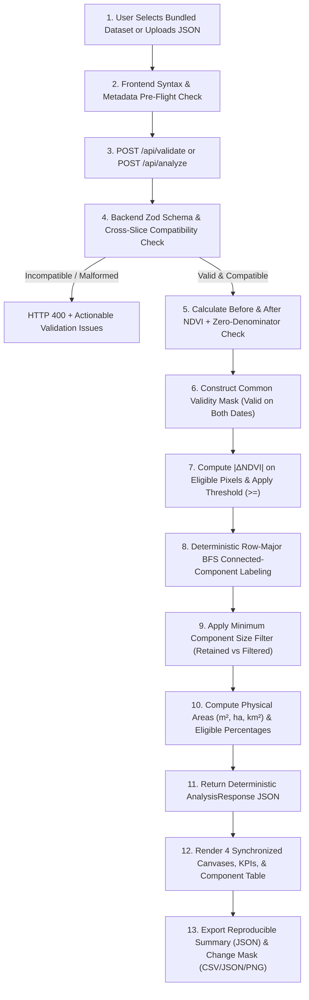

# System Architecture — PS08 Satellite Land Change Detection Tool (GeoVision)

## 1. Architectural Overview

**GeoVision (PS08)** is a deterministic, full-stack geospatial land-change detection system built with **React + TypeScript + Vite + Tailwind CSS** on the frontend and **Node.js + Express + TypeScript + Zod** on the backend.

The system is architected around a strict separation of concerns:
- **Presentation & Interactive Visualization Layer (`frontend/`)**: Renders synchronized multi-panel HTML5 Canvas visualizations (`Before NDVI`, `After NDVI`, `Change Detection Mask`, `Invalid Pixel Mask`), interactive connected-component inspection, pre-flight validation diagnostics, Recharts statistical summaries, and client-side reproducible export generation (`JSON`, `CSV`, `PNG`).
- **API & Validation Layer (`backend/src/routes/`, `backend/src/controllers/`, `backend/src/validation/`)**: Exposes stateless REST endpoints, enforces payload size limits, validates input schemas with Zod, and rejects incompatible temporal image slices with HTTP 400 and structured field-level diagnostics.
- **Deterministic Processing Engine (`backend/src/algorithms/`)**: Pure, side-effect-free TypeScript modules that compute per-date NDVI, construct the common validity mask, evaluate `|ΔNDVI| >= threshold`, label 8-connected or 4-connected components via deterministic row-major Breadth-First Search (BFS), apply minimum component size filtering, and calculate physical areas (`m²`, `ha`, `km²`) and eligible-pixel percentages.

No external paid satellite APIs, external AI services, or mandatory persistent databases are required; identical inputs and configurations deterministically produce identical outputs across local development, CI, Docker containers, and cloud deployments.

---

## 2. End-to-End Request & Processing Flow

1. **User selects or uploads a dataset**: The user selects one of the bundled synthetic datasets (`GET /api/examples/:datasetId`) or uploads a custom `.json` temporal dataset file in the frontend.
2. **Frontend validates the file and settings**: The frontend parses the JSON syntax, displays dataset metadata (`width`, `height`, `alignmentId`, `pixelWidthMeters`, `pixelHeightMeters`, `before.date`, `after.date`), and validates user-configured parameters (`threshold`, `minComponentSize`, `connectivity`).
3. **Frontend sends the request to the backend**: The frontend sends `POST /api/validate` or `POST /api/analyze` with `{ dataset, config }`.
4. **Backend validates schema, bands, dimensions, and alignment**:
   - `inputParser.ts` extracts the dataset and configuration.
   - `schemaValidator.ts` enforces minimum `20 × 20` dimensions, finite normalized reflectance values in `[0.0, 1.0]` for `red` and `nir` bands, binary `0/1` values in `validMask`, and exact matrix row/column lengths.
   - `compatibilityChecker.ts` verifies that `before` and `after` share identical `width`, `height`, `alignmentId`, `coordinateSystem`, `pixelWidthMeters`, and `pixelHeightMeters`.
5. **Backend calculates the selected index**: `indexCalculator.ts` computes `NDVI = (NIR - Red) / (NIR + Red)` for each valid pixel on both dates and flags any zero-denominator `(NIR + Red) === 0` pixels as invalid (`null`).
6. **Backend creates the common validity mask**: `validityMask.ts` marks a pixel eligible (`commonValidMask[r][c] = 1`) if and only if it is valid and has a finite NDVI on *both* dates.
7. **Backend calculates pixel-level change**: `changeDetector.ts` computes `absoluteChange = |NDVI_after - NDVI_before|` for eligible pixels and marks candidate changed pixels where `absoluteChange >= threshold`.
8. **Backend groups connected changed pixels**: `connectedComponents.ts` performs deterministic row-major BFS using 8-connectivity (or 4-connectivity) on candidate changed pixels.
9. **Backend applies minimum-size filtering**: `componentFilter.ts` separates candidate components into `retained` (`pixelCount >= minComponentSize`) and `filteredOut` (`pixelCount < minComponentSize`), assigning stable sequential IDs (`1..N`) to retained components.
10. **Backend calculates areas and summary statistics**: `areaCalculator.ts` and `reportGenerator.ts` compute physical areas (`m²`, `ha`, `km²`) using `pixelWidthMeters × pixelHeightMeters` and calculate change percentages using `eligiblePixelCount` as the denominator.
11. **Backend returns results**: The Express controller responds with HTTP 200 and the complete `AnalysisResponse` JSON payload.
12. **Frontend renders the visualizations**: The React UI updates the 5 KPI cards, 4 synchronized raster canvases, component table, and statistical charts.
13. **User downloads the results**: The user exports the reproducible Analysis Summary (`JSON`) and Pixel-Level Change Mask (`CSV`, `JSON`, or `PNG`).

---

## 3. Module Responsibilities

### Backend (`backend/src/`)

| Module Path | Responsibility |
| :--- | :--- |
| `types/landChange.ts` | Canonical TypeScript interfaces for datasets, configurations, validation issues, components, rasters, and analysis reports. |
| `validation/inputParser.ts` | Safely parses raw request payloads and normalizes configuration parameters. |
| `validation/schemaValidator.ts` | Runtime Zod schemas enforcing `schemaVersion: "1.0"`, dimensions `>= 20×20`, band definitions (`red`, `nir` in `[0, 1]`), and binary `validMask` arrays. |
| `validation/compatibilityChecker.ts` | Verifies cross-temporal compatibility (`width`, `height`, `alignmentId`, `coordinateSystem`, `pixelWidthMeters`, `pixelHeightMeters`). |
| `algorithms/indexCalculator.ts` | Computes per-date NDVI and isolates zero-denominator `(NIR + Red = 0)` pixels as invalid. |
| `algorithms/validityMask.ts` | Combines per-date effective validity masks into `commonValidMask` and `invalidMask`. |
| `algorithms/changeDetector.ts` | Calculates signed and absolute NDVI differences on eligible pixels and applies `>= threshold`. |
| `algorithms/connectedComponents.ts` | Groups adjacent candidate changed pixels into connected components via 8-connected or 4-connected BFS. |
| `algorithms/componentFilter.ts` | Filters components by `minComponentSize`, assigns deterministic IDs, and builds `retainedChangeMask`, `classificationMask`, and `componentLabelMask`. |
| `algorithms/areaCalculator.ts` | Computes physical area in square meters (`m²`), hectares (`ha`), and square kilometers (`km²`). |
| `algorithms/reportGenerator.ts` | Orchestrates the 10-step pipeline and compiles summary metrics, warnings, and limitations. |
| `algorithms/exportSerializer.ts` | Serializes reproducible Summary JSON, Mask CSV, and Mask JSON outputs. |
| `services/datasetService.ts` | Serves bundled synthetic datasets from `backend/sample_data/`. |
| `controllers/apiController.ts` | Express route handlers for `/api/health`, `/api/examples`, `/api/validate`, `/api/analyze`, and `/api/docs`. |

### Frontend (`frontend/src/`)

| Module Path | Responsibility |
| :--- | :--- |
| `services/api.ts` | Typed HTTP client communicating with the backend API via `VITE_API_BASE_URL`. |
| `components/Sidebar.tsx` | Dark-navy navigation sidebar (`Overview`, `New Analysis`, `Results`, `Sample Datasets`, `Methodology`, `API Documentation`). |
| `components/TopBar.tsx` | Application header with dataset selector, synthetic origin badge, and live API health status. |
| `components/KpiCards.tsx` | Top 5 summary metric cards (`Image Size`, `Valid Pixels`, `Changed Pixels`, `Change Groups`, `Total Change Area`). |
| `components/RasterVisualizer.tsx` | 4 synchronized HTML5 Canvas views (`Before NDVI`, `After NDVI`, `Change Detection`, `Invalid Pixel Mask`) with pixel telemetry and component isolation. |
| `pages/OverviewPage.tsx` | Main geospatial workspace integrating canvases, configuration sliders, statistics, interpretation notes, component table, and exports. |
| `pages/NewAnalysisPage.tsx` | Dataset loader, custom JSON uploader, metadata inspector, and pre-flight validation view. |
| `pages/ResultsPage.tsx` | Detailed analytical report with Recharts charts and full connected-component catalog. |
| `pages/SampleDatasetsPage.tsx` | Catalog of bundled synthetic datasets with one-click analysis and raw JSON download. |
| `pages/MethodologyPage.tsx` | Mathematical formulas, complexity analysis, and remote-sensing limitation reference. |
| `pages/ApiDocsPage.tsx` | Interactive OpenAPI 3.0 viewer and live `/api/health` probe. |
| `utils/exportHelpers.ts` | Generates downloadable Summary JSON, Change Mask CSV, Change Mask JSON, and annotated Change Mask PNG files. |

---

## 4. REST API Contract Summary

- `GET /api/health` → `200 OK`: `{ status: "ok", service: "ps08-land-change-backend", version: "1.0.0", engine: "deterministic-ndvi-connected-components", timestamp }`
- `GET /api/examples` → `200 OK`: `{ count, datasets: DatasetCatalogEntry[] }`
- `GET /api/examples/:datasetId` → `200 OK` (`LandChangeDataset`) or `404 Not Found`
- `POST /api/validate` → `200 OK` (`{ valid: true, issues: [], warnings, summary }`) or `400 Bad Request` (`{ error: "VALIDATION_FAILED", valid: false, issues, warnings }`)
- `POST /api/analyze` → `200 OK` (`AnalysisResponse`) or `400 Bad Request` (`{ error: "VALIDATION_FAILED", valid: false, issues, warnings }`)
- `GET /api/docs` → `200 OK` (OpenAPI 3.0.3 JSON specification, or Swagger UI HTML with `?format=html`)
