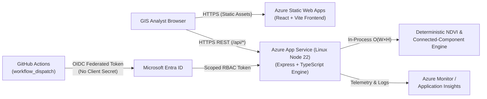

# Azure Deployment Architecture & OIDC Plan — PS08 Satellite Land Change Detection Tool

> [!NOTE]
> Our primary active deployment targets **Vercel** (Frontend) and **Render** (Backend). This document and the accompanying `.github/workflows/deploy-azure.yml` workflow provide the complete alternative **Microsoft Azure** enterprise deployment design using **Azure App Service** and **OpenID Connect (OIDC)** federated identity as required by the Cerevyn PS08 assessment.

---

## 1. Architecture & Request Flow on Azure

1. **Frontend Hosting (`Azure Static Web Apps` — Free Tier)**:
   - Serves the compiled React + TypeScript + Tailwind SPA (`frontend/dist`).
   - Built with `VITE_API_BASE_URL` pointing to the Azure App Service HTTPS origin (`https://<app-name>.azurewebsites.net`).
2. **Backend Hosting (`Azure App Service on Linux` — Node 22 LTS)**:
   - Runs the stateless Express API (`backend/dist/server.js`) and bundles the deterministic synthetic datasets (`backend/sample_data/`).
   - Because all NDVI, validity mask, and connected-component calculations are deterministic and local to the Node.js process, **no paid satellite APIs, external databases, or Azure Cognitive Services are required**.

---

## 2. Identity, OpenID Connect (OIDC), & Least-Privilege Access

Instead of storing long-lived `AZURE_CREDENTIALS` client secrets in GitHub, `.github/workflows/deploy-azure.yml` uses **Microsoft Entra ID Workload Identity Federation (OIDC)**:

### Required Azure Resources & Federated Credential Setup
1. **Microsoft Entra Application & Service Principal**:
   - Create an App Registration (e.g., `ps08-github-oidc-deployer`) in your Azure Tenant.
2. **Federated Credential Configuration**:
   - **Issuer**: `https://token.actions.githubusercontent.com`
   - **Audience**: `api://AzureADTokenExchange`
   - **Subject Identifier**:
     - For environment-scoped runs: `repo:<GITHUB_ORG_OR_USER>/<REPO_NAME>:environment:production`
     - Or for branch-scoped runs: `repo:<GITHUB_ORG_OR_USER>/<REPO_NAME>:ref:refs/heads/main`
3. **Least-Privilege RBAC Role Assignment**:
   - Assign the Service Principal the **Website Contributor** role scoped **strictly** to the target Azure App Service resource (or Resource Group), rather than Subscription-wide Owner/Contributor rights.

### Required GitHub Secrets & Repository Variables

| Type | Name | Description |
| :--- | :--- | :--- |
| **Secret** | `AZURE_CLIENT_ID` | Application (client) ID of the Entra ID App Registration. |
| **Secret** | `AZURE_TENANT_ID` | Directory (tenant) ID of your Microsoft Entra ID tenant. |
| **Secret** | `AZURE_SUBSCRIPTION_ID` | Target Azure Subscription ID. |
| **Variable** | `AZURE_WEBAPP_NAME` | Name of the Azure App Service instance (e.g., `ps08-landchange-api`). |
| **Variable** | `AZURE_WEBAPP_URL` | Optional base URL (`https://ps08-landchange-api.azurewebsites.net`) for post-deploy `/api/health` verification. |

---

## 3. Build, Runtime Configuration & Secret Management

### Build & Deployment Workflow (`.github/workflows/deploy-azure.yml`)
- Triggered **manually** via `workflow_dispatch` (never runs automatically on every push, preventing accidental cloud spend or failed runs when Azure secrets are unconfigured).
- Executes `npm ci`, `npm run typecheck`, `npm test`, `npm run build`, and `npm prune --omit=dev` inside `backend/`.
- Packages `package.json`, `package-lock.json`, `dist/`, `sample_data/`, and production `node_modules/` into `ps08-backend-release.zip`.
- Authenticates via `azure/login@v2` using OIDC (`permissions: id-token: write`) and deploys via `azure/webapps-deploy@v3`.

### Azure App Service Runtime Settings
Configure the following Application Settings on the Azure App Service resource:
- `NODE_ENV=production`
- `PORT=8080` (Azure App Service injects `PORT` dynamically; `backend/src/server.ts` binds to `process.env.PORT || 4000` on `0.0.0.0`)
- `CORS_ALLOWED_ORIGINS=https://<your-static-web-app-or-vercel-domain>`
- `MAX_PAYLOAD_SIZE=15mb`
- `SCM_DO_BUILD_DURING_DEPLOYMENT=false` (since the workflow builds and packages the compiled `dist/` artifact in CI).

---

## 4. Health Checks, Logging, Monitoring & Error Handling

- **Health Check Path**: Configure Azure App Service **Health Check** to probe `/api/health` every 1 minute. Unhealthy instances failing 3 consecutive probes are automatically recycled.
- **Logging & Monitoring**:
  - Enable **App Service Application Logging (Filesystem / Azure Monitor)** to capture standard output (`stdout` / `stderr`) from the Express process.
  - Optional: Attach **Azure Application Insights** (Free daily ingestion cap) to track HTTP 4xx/5xx rates, p95 `/api/analyze` latency, and memory footprint.
- **Error Handling**:
  - The Express error middleware returns structured HTTP `400` responses for validation failures and malformed JSON, HTTP `413` for oversized payloads, and sanitized HTTP `500` responses without leaking internal stack traces.

---

## 5. Cost-Control Assumptions & Rollback Strategy

### Cost Control
- **App Service Plan**: Use the **Free (`F1`)** or **Basic (`B1`)** Linux plan during assessment demonstrations.
- **Static Web Apps**: Use the **Free** tier.
- **Zero External API Spend**: Processing is 100% deterministic in-memory array math; no paid satellite imagery feeds or cloud database instances are billed.

### Deployment & Rollback
- Every `workflow_dispatch` run produces an immutable commit-linked `.zip` package deployed via ZipDeploy.
- To roll back a defective release:
  1. Re-run `.github/workflows/deploy-azure.yml` from the previous known-good Git commit or tag, **or**
  2. On `Standard (S1)` plans, use **Deployment Slots** (`staging` → `production` swap) and swap back immediately if `/api/health` fails.

---

## 6. Comparison: Azure Design vs. Vercel + Render Deployment

| Aspect | Primary Deployment (Vercel + Render) | Alternative Enterprise Plan (Azure) |
| :--- | :--- | :--- |
| **Frontend Host** | Vercel (`vercel.json`) | Azure Static Web Apps |
| **Backend Host** | Render Web Service (`render.yaml` / `Dockerfile`) | Azure App Service on Linux (Node 22 LTS) |
| **Deployment Trigger** | Git integration / Blueprint sync | Manual `workflow_dispatch` via `.github/workflows/deploy-azure.yml` |
| **Authentication** | GitHub App OAuth (Vercel/Render) | Microsoft Entra ID OIDC Federated Credentials (`azure/login@v2`) |
| **Health Probe** | Render `healthCheckPath: /api/health` | Azure App Service Health Check `/api/health` |
| **Processing Engine** | Identical stateless Node.js + TypeScript engine | Identical stateless Node.js + TypeScript engine |
